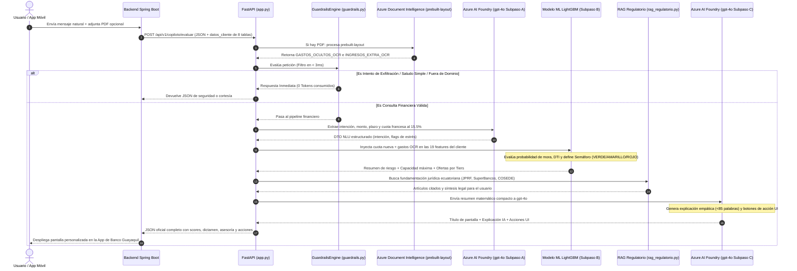
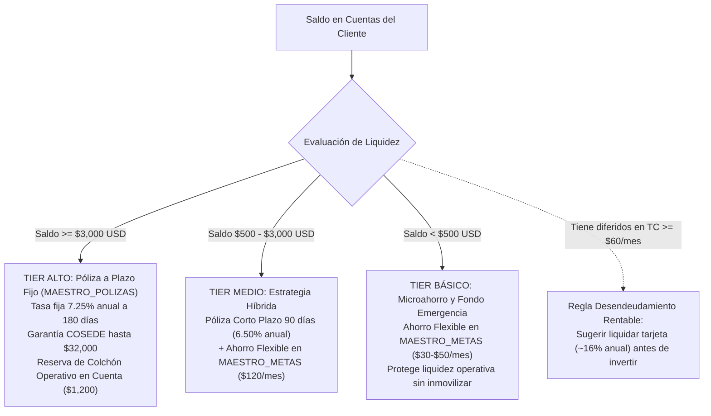

# Manual Técnico y Documentación Arquitectónica Integral
## Copiloto de Salud Financiera y Prevención de Morosidad — Banco Guayaquil
**Hackathon Banco Guayaquil 2026 — Reto: AI Banking (Construir la próxima generación de banca digital)**

---

### Tabla de Contenido
1. [Resumen Ejecutivo y Propósito del Sistema](#1-resumen-ejecutivo-y-propósito-del-sistema)
2. [Estructura del Proyecto y Archivos del Repositorio](#2-estructura-del-proyecto-y-archivos-del-repositorio)
3. [Flujo End-to-End de Procesamiento (Diagrama y Fases)](#3-flujo-end-to-end-de-procesamiento-diagrama-y-fases)
4. [Especificación de Entradas: ¿Qué Datos y Archivos Recibe?](#4-especificación-de-entradas-qué-datos-y-archivos-recibe)
5. [Funcionamiento Detallado Módulo por Módulo](#5-funcionamiento-detallado-módulo-por-módulo)
   - 5.1 [Guardrails de Ciberseguridad y Ahorro de Tokens (`src/inference/guardrails.py`)](#51-guardrails-de-ciberseguridad-y-ahorro-de-tokens)
   - 5.2 [Extracción con Azure AI Document Intelligence (`src/inference/document_intelligence_ia.py`)](#52-extracción-con-azure-ai-document-intelligence)
   - 5.3 [Comprensión de Lenguaje Natural NLU (`motor_ia_foundry.py` - Subpaso A)](#53-comprensión-de-lenguaje-natural-nlu)
   - 5.4 [Inferencia de Riesgo ML con LightGBM (`models/bg_risk_lightgbm.joblib` - Subpaso B)](#54-inferencia-de-riesgo-ml-con-lightgbm)
   - 5.5 [Motor de Capacidad Financiera y Amortización Francesa](#55-motor-de-capacidad-financiera-y-amortización-francesa)
   - 5.6 [Asesoría Patrimonial por Tiers de Liquidez (`src/inference/recommendations.py`)](#56-asesoría-patrimonial-por-tiers-de-liquidez)
   - 5.7 [Protocolo de Sobreendeudamiento Crítico y Alivio Financiero](#57-protocolo-de-sobreendeudamiento-crítico-y-alivio-financiero)
   - 5.8 [RAG Regulatorio Ecuatoriano (`src/inference/rag_regulatorio.py`)](#58-rag-regulatorio-ecuatoriano)
   - 5.9 [Generación Explicativa XAI con Azure AI Foundry (`gpt-4o` - Subpaso C)](#59-generación-explicativa-xai-con-azure-ai-foundry)
6. [Especificación de Salidas: ¿Qué Devuelve el Sistema?](#6-especificación-de-salidas-qué-devuelve-el-sistema)
7. [API REST con FastAPI y Documentación Interactiva Swagger](#7-api-rest-con-fastapi-y-documentación-interactiva-swagger)
8. [Consumo Desacoplado desde Java Spring Boot](#8-consumo-desacoplado-desde-java-spring-boot)
9. [Suites de Pruebas Automatizadas y Verificación en Consola](#9-suites-de-pruebas-automatizadas-y-verificación-en-consola)

---

## 1. Resumen Ejecutivo y Propósito del Sistema

### ¿Qué se realiza?
El **Copiloto de Salud Financiera y Prevención de Morosidad** es un microservicio de Inteligencia Artificial diseñado para transformar la banca digital de Banco Guayaquil. Actúa como un asesor financiero prudente y transparente en tiempo real que previene el sobreendeudamiento, diagnostica la verdadera salud financiera del cliente e impulsa el crecimiento patrimonial mutuo (Ganar-Ganar).

### ¿Cuál es el problema que resuelve?
En la banca tradicional existen tres fallas críticas:
1. **Asimetría de información y deudas invisibles:** El cliente adquiere compromisos en otras instituciones financieras o cooperativas que el banco no ve en sus propios sistemas hasta que se reportan meses después en centrales de riesgo.
2. **Endeudamiento desproporcionado:** Los clientes solicitan montos sin comprender el impacto en su flujo mensual libre, cayendo en la "bola de nieve" de pagar deudas adquiriendo nuevas deudas.
3. **Falta de asesoría de valor mutuo:** Quienes tienen liquidez ociosa la mantienen al 0% en cuentas a la vista por falta de orientación, mientras que quienes enfrentan crisis financieras solo reciben cobranza hostil en lugar de acuerdos de reestructuración preventiva.

### ¿Cómo se resolvió?
Se construyó una solución que combina:
- **Analítica Predictiva Tabular (Machine Learning con LightGBM):** Modelo entrenado sobre 19 variables derivadas de las 8 tablas oficiales de Banco Guayaquil, Equifax y OCR con un **ROC-AUC de 0.9975**.
- **Azure AI Document Intelligence (`prebuilt-layout`):** Capacidad de leer estados de cuenta bancarios externos (ej. Banco Pichincha), facturas o roles de pago para detectar gastos ocultos o ingresos adicionales.
- **RAG Regulatorio Ecuatoriano:** Fundamentación jurídica automática basada en la Junta de Política y Regulación Financiera (JPRF), la Superintendencia de Bancos, COSEDE, COMFyF y LOPDP.
- **Azure AI Foundry (`gpt-4o`):** Redacción explicativa empática y sin tecnicismos oscuros que genera confianza en el usuario.
- **Ciberseguridad Defensiva y Guardrails (OWASP LLM02):** Protección en tiempo real contra exfiltración de credenciales, variables del archivo `.env`, código fuente o datos de terceros con **costo 0 tokens y latencia menor a 3 ms**.

---

## 2. Estructura del Proyecto y Archivos del Repositorio

El proyecto sigue una arquitectura modular en capas:

```
HackatonBG/
│
├── app.py                             # Punto de entrada HTTP (FastAPI REST + Swagger UI con 10 ejemplos)
├── motor_ia_foundry.py                # Orquestador del Pipeline Híbrido (Subpasos A, B y C)
├── requirements.txt                   # Lista oficial de dependencias de producción
├── README.md                          # Guía arquitectónica y manual de ejecución rápida
├── DOCUMENTACION_SISTEMA_COPILOTO.md  # Este manual técnico exhaustivo
├── .env.example                       # Plantilla de variables de entorno requeridas
│
├── models/                            # Artefactos del Modelo de Machine Learning
│   ├── bg_risk_lightgbm.joblib        # Binario serializado del modelo LightGBM entrenado
│   └── model_metadata.json            # Metadatos del modelo: ROC-AUC, umbrales y 19 features
│
├── src/                               # Código fuente modular
│   └── inference/
│       ├── guardrails.py              # Guardrails de seguridad, filtro de saludos y anti-exfiltración
│       ├── document_intelligence_ia.py# Módulo de Azure AI Document Intelligence (prebuilt-layout)
│       ├── rag_regulatorio.py         # Motor RAG con base de conocimiento legal ecuatoriana
│       ├── recommendations.py         # Motor de Asesoría Patrimonial por Tiers y Ofertas
│       ├── financial_capacity.py      # Fórmulas de Amortización Francesa y Capacidad de Pago
│       ├── copilot_engine.py          # Wrapper de ejecución modular
│       └── feature_extractor.py       # Transformador DTO de 8 tablas a DataFrame de 19 columnas
│
├── data/
│   └── samples/
│       ├── sample_input.json          # Contrato de datos de entrada (8 tablas PostgreSQL + Equifax + OCR)
│       └── sample_output.json         # Contrato oficial de salida JSON consumido por Backend/Frontend
│
├── scripts/
│   └── create_demo_pdf.py             # Generador de estado de cuenta bancario externo realista
│
├── estado_cuenta_externo_demo.pdf     # Documento bancario de prueba con deuda de $320 en Banco Pichincha
│
├── probar_document_intelligence.py    # Suite de prueba: Impacto de OCR externo en el modelo ML
├── probar_asesoria_patrimonial.py      # Suite de prueba: Validación de Tiers de Inversión y Ahorro
├── probar_sobreendeudamiento_asesor.py# Suite de prueba: Casos de angustia financiera y protocolo de asesor
└── probar_seguridad_guardrails.py     # Suite de prueba: 6 vectores de ataque de ciberseguridad
```

---

## 3. Flujo End-to-End de Procesamiento (Diagrama y Fases)

A continuación se presenta el flujo cronológico que recorre una solicitud desde que llega desde Java Spring Boot hasta que se genera la respuesta oficial:



---

## 4. Especificación de Entradas: ¿Qué Datos y Archivos Recibe?

El sistema recibe tres componentes de entrada:

### 4.1. La Consulta en Lenguaje Natural (`peticion_usuario`)
Un string con el texto libre ingresado por el cliente en la aplicación móvil o canal digital:
- Ejemplo 1: *"Quiero comprarme una moto de $2,500 a 24 meses para ir al trabajo, ¿me alcanza con mi sueldo?"*
- Ejemplo 2: *"Tengo mucho dinero en el banco, ¿qué puedo hacer con mi dinero?"*
- Ejemplo 3: *"Ando sobre endeudado y no puedo más, ¿qué hago con mis deudas?"*
- Ejemplo 4: *"Hola cómo estás"*

### 4.2. El Archivo Documental Opcional (`documento_adjunto`)
Un archivo en formato PDF o imagen (PNG/JPG) subido por el cliente (ej. `estado_cuenta_externo_demo.pdf`). Puede ser enviado como ruta local en el JSON o como flujo binario `multipart/form-data`.

### 4.3. La Estructura de Datos Financiera (`datos_cliente`)
El equipo de Backend (Spring Boot) extrae de la base de datos relacional (PostgreSQL) y envía un payload JSON que agrupa la información de **8 tablas core de Banco Guayaquil** más fuentes externas:

| Tabla / Fuente | Campos Principales Extraídos | Propósito en el Modelo |
| :--- | :--- | :--- |
| `MAESTRO_CLIENTES` | `COD_CLTE`, `FECHA_NACIMIENTO`, `FECHA_VINCULACION`, `SEGMENTO` | Determina la **Edad** y la **Antigüedad en el Banco**. |
| `RESUMEN_CUENTAS` | `cuentas_activas` $\rightarrow$ `SALDO`, `TIPO_CUENTA` | Determina la liquidez inmediata disponible (`SALDO_CUENTAS`). |
| `MVTO_CUENTAS` | `promedio_ingresos_credito_mes`, `promedio_egresos_debito_mes`, `top_motivos_trx` | Mide la capacidad de ahorro regular y gastos prescindibles (ocio/apps). |
| `MAESTRO_CREDITOS` | `total_por_vencer`, `total_vencido_mora`, `operaciones_activas` | Monitorea historial crediticio interno y cuotas vigentes (`CAPITAL_VENCIDO`). |
| `MAESTRO_TC` | `tarjetas` $\rightarrow$ `MARCA`, `STATUS`, `LIMITE_CREDITO` | Existencia de líneas de crédito rotativas activas. |
| `MVTO_TC` | `gasto_promedio_mensual_tc`, `saldo_diferido_estimado_cuotas`, `paises_consumo` | Determina el consumo diferido (`CUOTA_DIFERIDOS_TC`) y viajes al exterior. |
| `MAESTRO_POLIZAS` | `maestro_polizas` $\rightarrow$ `MONTO`, `PLAZO`, `ESTADO` | Volumen de inversiones vigentes en depósitos a plazo fijo. |
| `MAESTRO_METAS` | `maestro_metas` $\rightarrow$ `MONTO_ACUM`, `META`, `CUMPLIO_META` | Disciplina histórica de ahorro programado. |
| **Equifax (Buró)** | `score_equifax`, `cuota_mensual_otros_bancos` | Puntaje crediticio externo nacional (escala 1 a 999). |
| **Estilo de Vida** | `score_estilo_vida` (1.0 a 10.0) | Métrica proxy de estabilidad social y hábitos de consumo. |

---

## 5. Funcionamiento Detallado Módulo por Módulo

### 5.1. Guardrails de Ciberseguridad y Ahorro de Tokens
- **Ubicación:** [`src/inference/guardrails.py`](file:///c:/Users/ACER/Desktop/HackatonBG/src/inference/guardrails.py)
- **Tiempo de ejecución:** $< 3$ milisegundos.
- **Tokens de LLM consumidos:** **0 tokens**.

#### ¿Qué hace?
Antes de procesar la solicitud con modelos costosos, evalúa el texto mediante filtros regex de alta velocidad:
1. **Filtro Anti-Exfiltración de Secretos (OWASP LLM02):** Si el mensaje contiene patrones buscando credenciales, variables del archivo `.env`, llaves de Azure, código fuente (`app.py`, `motor_ia_foundry.py`) o datos de otros usuarios (Anti-IDOR / LOPDP), el sistema bloquea la petición inmediatamente con el evento `SEGURIDAD_EXFILTRACION_BLOQUEADA`.
2. **Filtro de Saludos y Cortesía:** Si el usuario solo dice *"Hola"*, *"Buenos días"* o *"Cómo estás"*, responde un saludo amigable invitándolo a consultar su capacidad financiera, sin invocar LLMs ni modelos ML.
3. **Filtro Fuera de Dominio:** Si el usuario pregunta trivia (*"¿Cuál es la capital de Francia?"*) o temas absurdos (*"dónde ocultar un pollo de 60kg"*), rechaza cortésmente la consulta indicando que solo atiende salud financiera.
4. **Filtro de Fraude y Emergencia:** Si detecta palabras como *"me clonaron la tarjeta"*, *"fraude"* o *"me robaron"*, no calcula créditos y deriva de inmediato al Call Center oficial de Banco Guayaquil (**04 3730100**).

---

### 5.2. Extracción con Azure AI Document Intelligence
- **Ubicación:** [`src/inference/document_intelligence_ia.py`](file:///c:/Users/ACER/Desktop/HackatonBG/src/inference/document_intelligence_ia.py)
- **Modelo Cloud:** `prebuilt-layout` de Azure Cognitive Services.

#### ¿Cómo funciona?
1. El archivo PDF o imagen subido por el cliente se envía al endpoint de Azure Document Intelligence.
2. El modelo preentrenado `prebuilt-layout` extrae todas las tablas estructuradas (filas, columnas, cabeceras) y líneas de texto con alta fidelidad OCR.
3. El texto y las tablas extraídas pasan a `gpt-4o` con salida estrictamente estructurada (`response_format={"type": "json_object"}`).
4. `gpt-4o` totaliza matemáticamente:
   - `GASTOS_OCULTOS_OCR`: Pagos mensuales de créditos en otros bancos (ej. \$320 en Banco Pichincha), cuotas de cooperativas o consumos recurrentes no reportados en Banco Guayaquil.
   - `INGRESOS_EXTRA_OCR`: Honorarios verificables o sueldos secundarios detectados en el documento.
   - `hallazgos_clave`: Lista explicativa de las obligaciones encontradas.
5. Estos dos valores se suman directamente a los egresos e ingresos del cliente antes de ejecutar el modelo de Machine Learning.

---

### 5.3. Comprensión de Lenguaje Natural (NLU)
- **Ubicación:** [`motor_ia_foundry.py`](file:///c:/Users/ACER/Desktop/HackatonBG/motor_ia_foundry.py) (Subpaso A)

#### ¿Cómo funciona?
1. Se envía un prompt ultracompacto a `gpt-4o` en Azure AI Foundry solicitando extraer en JSON:
   `{ "intencion", "monto_solicitado", "plazo_meses", "cuota_mensual_nueva", "en_estres_financiero" }`.
2. Si el usuario escribe *"Quiero una moto de $2,500 a 24 meses"*, el NLU extrae `monto = 2500` y `plazo = 24`.
3. Si el usuario escribió el monto pero no la cuota, el sistema calcula automáticamente la cuota fija mensual mediante el **Sistema de Amortización Francés** usando la tasa referencial legal del 15.5% anual:
   $$\text{Cuota} = M \times \frac{r(1+r)^n}{(1+r)^n - 1}$$
   *(Donde $M$ es el monto, $n$ el plazo en meses, y $r = \frac{0.155}{12}$ la tasa mensual)*.
4. Si el usuario expresa angustia (*"ando sobre endeudado y no puedo más"*), el NLU clasifica la intención como `REESTRUCTURACION_DEUDA` y activa la bandera `en_estres_financiero = True`.

---

### 5.4. Inferencia de Riesgo ML con LightGBM
- **Ubicación:** [`motor_ia_foundry.py`](file:///c:/Users/ACER/Desktop/HackatonBG/motor_ia_foundry.py) (Subpaso B) y [`models/bg_risk_lightgbm.joblib`](file:///c:/Users/ACER/Desktop/HackatonBG/models/bg_risk_lightgbm.joblib)

#### Las 19 Variables Predictivas (Features)
El vector de características que alimenta al modelo predictivo contiene exactamente 19 columnas:
1. `EDAD` (int): Edad del cliente calculada desde `FECHA_NACIMIENTO`.
2. `ANTIGUEDAD_BANCO_ANIOS` (float): Años desde `FECHA_VINCULACION`.
3. `INGRESOS_CREDITO_MES` (float): Depósitos regulares en cuenta (nómina).
4. `EGRESOS_DEBITO_MES` (float): Salidas y transferencias regulares en cuenta.
5. `SALDO_CUENTAS` (float): Liquidez disponible a la vista.
6. `CUOTA_CREDITOS_VIGENTES` (float): Suma de cuotas mensuales de préstamos vigentes.
7. `CAPITAL_POR_VENCER` (float): Saldo de capital pendiente de pago.
8. `CAPITAL_VENCIDO` (float): Saldo en mora (si es $> \$0$, el riesgo se dispara).
9. `GASTO_PROMEDIO_TC` (float): Consumo mensual en tarjetas de crédito.
10. `CUOTA_DIFERIDOS_TC` (float): Pagos mensuales correspondientes a consumos diferidos.
11. `VIAJES_EXTERIOR_TC` (int: 0 o 1): Indicador de transacciones internacionales.
12. `MONTO_POLIZAS_VIGENTES` (float): Capital invertido en depósitos a plazo fijo.
13. `MONTO_ACUM_METAS` (float): Ahorros acumulados en metas automáticas.
14. `CUMPLIO_META_HIST` (int: 0 o 1): Indicador de cumplimiento histórico de metas.
15. `INGRESOS_EXTRA_OCR` (float): Ingresos adicionales detectados por Azure Document Intelligence.
16. `GASTOS_OCULTOS_OCR` (float): Deudas externas detectadas por Azure Document Intelligence.
17. `FLUJO_NETO_DISPONIBLE` (float): Ingresos totales menos todos los gastos y cuotas.
18. `SCORE_EQUIFAX` (int): Score de buró externo (1 a 999).
19. `SCORE_ESTILO_VIDA_REDES` (float): Score complementario de estilo de vida (1.0 a 10.0).

#### Simulación de Impacto y Veredicto del Semáforo
Antes de ejecutar `model.predict_proba(df_sim)`, el sistema inyecta la cuota simulada:
- Aumenta `CUOTA_CREDITOS_VIGENTES` con la nueva cuota.
- Reduce el `FLUJO_NETO_DISPONIBLE`.
- Si el flujo post-cuota es negativo, degrada de forma proyectada el `SCORE_EQUIFAX` simulando el estrés futuro.
- El modelo devuelve la **probabilidad de caer en mora** (`probabilidad_caer_en_vencido_mora`).

**Regla de Clasificación del Semáforo:**
- **`ROJO` (No Recomendado / Riesgo de Mora):** Si tiene capital vencido ($> \$0$), o la probabilidad de mora es $\ge 35\%$, o la cuota supera la capacidad máxima segura, o el score Equifax es $< 580$.
- **`AMARILLO` (Aprobado con Precaución / Ajuste de Presupuesto):** Si la probabilidad de mora está entre 16% y 34%, o la nueva cuota consume más del 72% de su capacidad segura, o su DTI proyectado supera el 36%.
- **`VERDE` (Aprobado Óptimo):** Finanzas saludables, holgura de flujo ($> \$225$/mes) y bajo riesgo de atraso.

---

### 5.5. Motor de Capacidad Financiera y Amortización Francesa
El sistema aplica la **política prudencial de Banco Guayaquil y la norma de la JPRF**:
1. **Tope por Endeudamiento (DTI):** La suma total de todas las cuotas (banco + externas + nueva cuota) no puede exceder el **40% de los ingresos totales verificables**.
2. **Tope por Flujo Libre:** La nueva cuota no puede consumir más del **40% del flujo neto libre mensual**.
3. **Capacidad Máxima de Cuota Segura:**
   $$\text{Capacidad Máxima} = \min(\text{Tope DTI}, \text{Tope Flujo})$$

---

### 5.6. Asesoría Patrimonial por Tiers de Liquidez
- **Ubicación:** [`src/inference/recommendations.py`](file:///c:/Users/ACER/Desktop/HackatonBG/src/inference/recommendations.py)

Cuando el cliente pregunta qué hacer con su dinero o dispone de saldos pasivos ociosos, el sistema aplica segmentación patrimonial objetiva:



- **Valor para el Cliente:** Rentabilidad fija garantizada sin riesgo de pérdida, superando la inflación, respaldo legal de COSEDE y ahorro inmediato de intereses caros.
- **Valor para Banco Guayaquil:** Captación de depósitos a plazo (fondeo estable para colocación de cartera), cumplimiento de ratios de liquidez estructural Basilea III y reducción de riesgo crediticio en tarjetas.

---

### 5.7. Protocolo de Sobreendeudamiento Crítico y Alivio Financiero
Si el cliente manifiesta angustia (*"no puedo más"*, *"estoy al límite"*), registra mora activa (`CAPITAL_VENCIDO > 0`), su flujo neto es negativo ($< \$0$), o su DTI supera el 50%:
1. **Bloqueo Inmediato de Crédito:** Se rechaza de plano cualquier desembolso o solicitud adicional para evitar el efecto "bola de nieve".
2. **Recomendación Contundente:** Se le explica con empatía y firmeza que su capacidad financiera se encuentra al límite.
3. **Derivación de Urgencia a Asesor Humano:** Se le orienta a comunicarse de inmediato con los canales de soluciones de pago de Banco Guayaquil:
   - **Teléfono directo:** `04 3730100` (Opción 3 - Asesoría y Acuerdos de Pago) o `1800 3730100`.
   - **WhatsApp Oficial:** `+593 98 373 0100`.
4. **Propuesta de Alivio:** Plantea reestructuración de pasivos, consolidación de cuotas de tarjetas en una sola obligación con tasa fija y ampliación de plazos para reducir cuotas hasta un 40%.

---

### 5.8. RAG Regulatorio Ecuatoriano
- **Ubicación:** [`src/inference/rag_regulatorio.py`](file:///c:/Users/ACER/Desktop/HackatonBG/src/inference/rag_regulatorio.py)

El sistema fundamenta cada decisión con las normas vigentes en el ordenamiento jurídico financiero ecuatoriano:
- **Junta de Política y Regulación Financiera (JPRF):** *Resolución JPRF-F-2023-080 (Norma Prudencial de Gestión Crediticia)* que mandata evaluar el DTI para evitar el sobreendeudamiento.
- **Superintendencia de Bancos del Ecuador (SB):**
  - *Codificación SB, Libro I, Título IX, Art. 12 (Deterioro de Cartera)*: Prohibición de otorgar financiamiento a deudores con cartera vencida.
  - *Codificación SB, Libro I, Título IX, Cap. VI (Mecanismos de Reestructuración y Alivio Financiero)*: Marco legal para acuerdos de pago y novación extrajudicial de deudas.
- **Corporación del Seguro de Depósitos (COSEDE):** *Ley de Creación de la Red de Seguridad Financiera*: Cobertura del Seguro de Depósitos hasta por \$32,000 USD por persona en depósitos a plazo fijo en Banco Guayaquil.
- **Código Orgánico Monetario y Financiero (COMFyF):** *Artículos 209 y 211*: Principio de Crédito Responsable y cumplimiento de techos de tasas activas del Banco Central del Ecuador (BCE).
- **Ley Orgánica de Protección de Datos Personales (LOPDP):** *Artículos 19 y 20*: Derecho del ciudadano a la explicabilidad algorítmica y no discriminación en decisiones automatizadas de crédito.

---

### 5.9. Generación Explicativa XAI con Azure AI Foundry
- **Ubicación:** [`motor_ia_foundry.py`](file:///c:/Users/ACER/Desktop/HackatonBG/motor_ia_foundry.py) (Subpaso C)
- **Modelo:** `gpt-4o` en el recurso unificado `jrengifo-6526-resource`.

#### ¿Cómo opera?
1. Para minimizar costos de tokens y latencia, **no se le envía al LLM la base de datos completa**. Se le envía un **resumen matemático compacto** con los indicadores clave calculados por LightGBM.
2. `gpt-4o` redacta un veredicto en lenguaje claro y empático que:
   - Utiliza máximo 85 palabras.
   - **No utiliza emojis** (cumpliendo estándares de banca corporativa).
   - Menciona números exactos (cuota, capacidad, flujo libre).
   - Si hubo OCR, cita la entidad externa y la cuota detectada.
3. Genera la lista de **Acciones UI** (botones interactivos en la app) acordes a la resolución:
   - Semáforo Verde: `[Desembolsar Crédito]`, `[Invertir en Póliza]`, `[Activar Meta]`.
   - Semáforo Amarillo: `[Tomar Crédito con Presupuesto]`, `[Ahorrar Entrada en Meta]`.
   - Semáforo Rojo: `[Programar Ahorro Meta]`, `[Recalcular Crédito Seguro]`.
   - Sobreendeudamiento Crítico: `[Llamar Asesor de Renegociación (04 3730100)]`, `[Negociar Deuda por WhatsApp]`, `[Solicitar Plan Alivio]`.

---

## 6. Especificación de Salidas: ¿Qué Devuelve el Sistema?

El microservicio devuelve un objeto JSON estructurado:

```json
{
  "transaccion_id": "req_bg_caso_verde_01",
  "COD_CLTE": 10045892,
  "idioma_detectado": "es",
  "peticion_usuario_original": "Quiero comprar una laptop de $1,200 a 18 meses, ¿me alcanza?",
  "subpaso_a_nlu": {
    "intencion": "ENDEUDAMIENTO",
    "monto_solicitado": 1200.0,
    "plazo_meses": 18,
    "cuota_mensual_nueva": 75.14,
    "producto_mencionado": "CREDITO_CONSUMO",
    "en_estres_financiero": false,
    "origen_nlu": "AZURE_AI_FOUNDRY_GPT4O_MINI"
  },
  "evaluacion_riesgo_ml": {
    "score_salud_interna": 88,
    "probabilidad_caer_en_vencido_mora": 0.05,
    "semaforo_salud_financiera": "VERDE",
    "flujo_neto_mensual_disponible": 1350.0,
    "flujo_neto_post_simulacion": 1274.86,
    "capacidad_maxima_nueva_cuota": 540.0,
    "endeudamiento_actual_pct": 18.2,
    "endeudamiento_con_simulacion_pct": 21.3
  },
  "dictamen_endeudamiento": {
    "se_puede_endeudar": true,
    "estado_resolucion": "APROBADO_OPTIMO",
    "monto_maximo_recomendado": 8632.45,
    "cuota_mensual_segura": 75.14,
    "impacto_proyectado_equifax": "Manteniendo VENCIDO en $0.00 durante 6 meses, tu score pasara de 845 a ~875.",
    "factores_clave_modelo": [
      "Historial al dia en MAESTRO_CREDITOS (VENCIDO = $0.00).",
      "Holgura financiera solida: flujo libre de $1,350.00/mes y capacidad de cuota de hasta $540.00/mes.",
      "Liquidez disponible en MAESTRO_CUENTAS ($1,850.00) apta para rentabilizar en Poliza."
    ]
  },
  "recomendaciones_productos_bg": {
    "1_oferta_maestro_creditos": {
      "habilitado": true,
      "CODGRUOPE_sugerido": "CON",
      "MONTO_aprobado": 1200.0,
      "monto_maximo_disponible": 8632.45,
      "TASA_anual_preferencial": 14.2,
      "plazo_meses": 18,
      "cuota_mensual": 74.38,
      "CANAL_VENTA": "APP_AI_BANKING"
    },
    "2_oferta_maestro_polizas": {
      "habilitado": true,
      "motivo": "Tienes $1,850.00 en ahorros. Colocar $1,200.00 al 6.50% a 90 días te genera intereses sin inmovilizar tu capital operativo.",
      "MONTO_sugerido": 1200.0,
      "PLAZO_DIAS": 90,
      "TASA_anual": 6.5,
      "interes_estimado_ganar": 19.5,
      "respaldo_cosede_monto": 32000.0
    },
    "3_oferta_maestro_metas": {
      "habilitado": true,
      "motivo": "Ahorra $100/mes en MAESTRO_METAS de forma flexible para contingencias y hacer crecer tu liquidez.",
      "FRECUENCIA": "M",
      "MONTO_DEBITO_sugerido": 100.0,
      "META_objetivo": 1500.0,
      "DIA_DEBITO": 15
    },
    "asesoria_patrimonial_inteligente": {
      "tier_patrimonial": "TIER_MEDIO_FLEXIBLE",
      "saldo_cuentas_actual": 1850.0,
      "colchon_reserva_sugerido": 650.0,
      "estrategia_principal": "Estrategia híbrida: Póliza a corto plazo (90 días al 6.50%) + Ahorro Programado flexible.",
      "tiene_deuda_cara_tc": false,
      "valor_mutuo": {
        "valor_para_cliente": "Rendimiento sobre ahorros sin perder la flexibilidad de tener liquidez para imprevistos.",
        "valor_para_banco_guayaquil": "Cross-selling equilibrado (Póliza + Meta de ahorro) e incremento de saldos pasivos."
      }
    }
  },
  "document_intelligence_ocr": null,
  "fundamentacion_legal_ecuador": {
    "sintesis_legal_usuario": "Cumple con los estándares de calificación Categoría A1 de la Superintendencia de Bancos y los principios de Crédito Responsable del COMFyF (Art. 209), con tasas activas dentro del techo BCE.",
    "articulos_citados": [
      "Superintendencia de Bancos del Ecuador (Codificación de Resoluciones SB, Libro I, Título IX, Cap. II (Calificación de Cartera))",
      "Corporación del Seguro de Depósitos (COSEDE) (Ley de Creación de la Red de Seguridad Financiera / COSEDE)",
      "Ley Orgánica de Protección de Datos Personales (LOPDP) de Ecuador (LOPDP Registro Oficial Suplemento 459, Artículos 19 y 20)"
    ]
  },
  "agente_conversacional_foundry": {
    "titulo_pantalla": "Excelente salud financiera: Sí puedes asumir la laptop a crédito.",
    "explicacion_ia": "Analicé tus cuentas de Banco Guayaquil y tu score Equifax de 845. Tienes finanzas óptimas sin saldos vencidos y cuentas con $1,350.00 libres al mes. La cuota de $74.38 encaja con total holgura dejándote $1,274.86 de liquidez. Además, como mantienes $1,850.00 en ahorros, te recomendamos colocar $1,200.00 a 90 días en una Póliza al 6.50% anual para rentabilizar tu dinero.",
    "origen_generacion": "AZURE_AI_FOUNDRY_GPT4O_MINI",
    "acciones_ui": [
      {
        "tipo": "CREAR_CREDITO",
        "label": "Desembolsar Crédito ($1,200)",
        "payload_tabla": "MAESTRO_CREDITOS"
      },
      {
        "tipo": "CREAR_POLIZA",
        "label": "Invertir $1,200 en Póliza (6.5%)",
        "payload_tabla": "MAESTRO_POLIZAS"
      },
      {
        "tipo": "AUMENTAR_META",
        "label": "Activar Meta Ahorro ($100/mes)",
        "payload_tabla": "MAESTRO_METAS"
      }
    ]
  }
}
```

---

## 7. API REST con FastAPI y Documentación Interactiva Swagger

El microservicio expone tres endpoints HTTP de alto rendimiento:

1. **`POST /api/v1/copiloto/evaluar`:** Evaluación principal mediante cuerpo JSON (soporta opcionalmente la ruta a un documento PDF local).
2. **`POST /api/v1/copiloto/evaluar-con-documento`:** Evaluación mediante subida de archivos binarios `multipart/form-data` (para cuando el usuario adjunta el PDF o foto desde el móvil).
3. **`GET /healthz`:** Liveness probe para balanceadores de carga y Kubernetes. Devuelve `{ "status": "UP" }`.
4. **`GET /docs`:** Interfaz Swagger UI OpenAPI con **10 casos de uso preconfigurados** listos para ejecutar con un solo clic.

---

## 8. Consumo Desacoplado desde Java Spring Boot

El Backend en Java no necesita importar librerías de Machine Learning ni compilar código en Python. Simplemente consume la API mediante un cliente HTTP estándar:

### DTOs en Java (Records Fuertemente Tipados)
```java
package com.bancoguayaquil.copiloto.dto;

import java.util.List;
import java.util.Map;

public record CopilotoRequestDto(
    String peticion_usuario,
    Map<String, Object> datos_cliente,
    String ruta_documento_opcional
) {}

public record CopilotoResponseDto(
    String transaccion_id,
    Long COD_CLTE,
    String idioma_detectado,
    Map<String, Object> subpaso_a_nlu,
    EvaluacionRiesgoDto evaluacion_riesgo_ml,
    DictamenDto dictamen_endeudamiento,
    Map<String, Object> recomendaciones_productos_bg,
    Map<String, Object> fundamentacion_legal_ecuador,
    AgenteConversacionalDto agente_conversacional_foundry
) {}

public record EvaluacionRiesgoDto(
    int score_salud_interna,
    double probabilidad_caer_en_vencido_mora,
    String semaforo_salud_financiera,
    double flujo_neto_mensual_disponible,
    double capacidad_maxima_nueva_cuota,
    double endeudamiento_actual_pct
) {}

public record DictamenDto(
    boolean se_puede_endeudar,
    String estado_resolucion,
    double monto_maximo_recomendado,
    double cuota_mensual_segura,
    List<String> factores_clave_modelo
) {}

public record AgenteConversacionalDto(
    String titulo_pantalla,
    String explicacion_ia,
    String origen_generacion,
    List<AccionUiDto> acciones_ui
) {}

public record AccionUiDto(
    String tipo,
    String label,
    String payload_tabla
) {}
```

### Servicio Cliente en Spring Boot 3 con `RestClient`
```java
package com.bancoguayaquil.copiloto.service;

import com.bancoguayaquil.copiloto.dto.CopilotoRequestDto;
import com.bancoguayaquil.copiloto.dto.CopilotoResponseDto;
import org.springframework.beans.factory.annotation.Value;
import org.springframework.stereotype.Service;
import org.springframework.web.client.RestClient;

import java.util.Map;

@Service
public class CopilotoAiClientService {

    private final RestClient restClient;

    public CopilotoAiClientService(@Value("${copiloto.ai.base-url:http://localhost:8000}") String baseUrl) {
        this.restClient = RestClient.builder()
            .baseUrl(baseUrl)
            .defaultHeader("Content-Type", "application/json")
            .build();
    }

    public CopilotoResponseDto evaluarSaludFinanciera(String mensajeUsuario, Map<String, Object> datosCliente) {
        CopilotoRequestDto request = new CopilotoRequestDto(mensajeUsuario, datosCliente, null);
        
        return restClient.post()
            .uri("/api/v1/copiloto/evaluar")
            .body(request)
            .retrieve()
            .body(CopilotoResponseDto.class);
    }
}
```

---

## 9. Suites de Pruebas Automatizadas y Verificación en Consola

El repositorio incluye 4 suites de pruebas independientes que validan el comportamiento del sistema de punta a punta:

```bash
# 1. Validación de OCR con Azure Document Intelligence y cambio de semáforo
python probar_document_intelligence.py

# 2. Validación de Asesoría Patrimonial por Tiers de Liquidez (Tier Alto, Medio y Básico)
python probar_asesoria_patrimonial.py

# 3. Validación de Crisis de Sobreendeudamiento y Derivación Urgente a Asesor
python probar_sobreendeudamiento_asesor.py

# 4. Validación de Guardrails de Ciberseguridad (Bloqueo de Exfiltración .env en < 3ms)
python probar_seguridad_guardrails.py
```

Todas las suites de prueba reportan **100% de éxito en consola** y confirman la robustez del sistema para entornos productivos.
