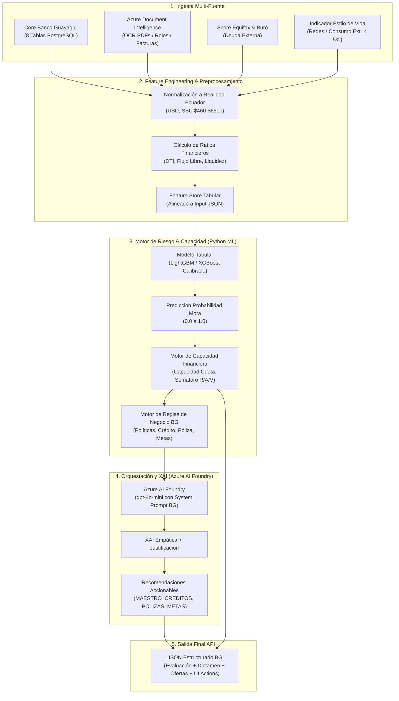

# Plan de Implementación: Copiloto de Salud Financiera y Prevención de Morosidad
**Hackathon Banco Guayaquil — Reto: AI Banking (Próxima Generación de Banca Digital)**
**Rol:** Senior AI/ML Engineer & Solutions Architect

---

## 1. Visión y Arquitectura de la Solución

El objetivo es construir un **Copiloto de Salud Financiera y Prevención de Morosidad** de grado bancario para Banco Guayaquil. La arquitectura desacopla estrictamente la lógica de cálculo financiero y riesgo crediticio (determinista y probabilística en ML) de la capa conversacional y explicativa (IA Generativa en Azure AI Foundry con `gpt-4o-mini`).

---

## 2. Alineación Estricta: Tablas Banco Guayaquil vs Features ML

Cada variable del dataset de entrenamiento y del JSON de inferencia mapea directamente a las 8 tablas oficiales:

| Tabla Oficial BG | Columnas Clave | Features Derivadas en el Dataset ML |
| :--- | :--- | :--- |
| `MAESTRO_CLIENTES` | `COD_CLTE`, `FECHA_NACIMIENTO`, `FECHA_VINCULACION`, `GENERO`, `ESTADO_CIVIL`, `SEGMENTO` | `EDAD`, `ANTIGUEDAD_BANCO_ANIOS`, `SEGMENTO_PREFERENTE` |
| `MAESTRO_CUENTAS` | `CUENTA`, `TIPO_CUENTA`, `ESTADO`, `SALDO` | `SALDO_CUENTAS` (Liquidez disponible en USD) |
| `MVTO_CUENTAS` | `FECHA_TRX`, `MONTO_TRX`, `TIPO_TRX` (D/C), `MOTIVO_TRX` | `INGRESOS_CREDITO_MES`, `EGRESOS_DEBITO_MES`, `RATIO_AHORRO_CUENTA` |
| `MAESTRO_CREDITOS` | `CODGRUOPE`, `MONTO`, `POR_VENCER`, `VENCIDO`, `TASA`, `FECHA_VENCIMIENTO` | `CAPITAL_POR_VENCER`, `CAPITAL_VENCIDO` (mora actual), `CUOTA_CREDITOS_VIGENTES` |
| `MAESTRO_TC` & `MVTO_TC` | `CUENTA_SYSTEM`, `MARCA`, `MONTO_TRX`, `CODPAIS_TRX`, `PLAZO_DIFERIDO` | `GASTO_PROMEDIO_TC`, `CUOTA_DIFERIDOS_TC`, `VIAJES_EXTERIOR_TC` (`CODPAIS != 'ECU'`) |
| `MAESTRO_POLIZAS` | `PLAZO_DIAS`, `TASA`, `MONTO` | `MONTO_POLIZAS_VIGENTES`, `TIENE_POLIZA_ACTIVA` |
| `MAESTRO_METAS` | `MONTO_DEBITO`, `META`, `MONTO_ACUM`, `ESTADO`, `CUMPLIO_META` | `MONTO_ACUM_METAS`, `CUMPLIO_META_HIST`, `RATIO_CUMPLIMIENTO_METAS` |
| **Fuentes Externas IA** | Buró Equifax + Azure Document Intelligence + Redes | `SCORE_EQUIFAX` (300-999), `DEUDA_OTROS_BANCOS`, `INGRESOS_EXTRA_OCR`, `GASTOS_OCULTOS_OCR`, `SCORE_ESTILO_VIDA_REDES` (peso < 5%) |

---

## 3. Plan de Fases de Ejecución

### Fase 1: Pipeline de Preparación y Enriquecimiento de Datos (Tarea Actual)
- [ ] **Descarga / Extracción de Datos Base de Comportamiento:**
  - Descargar dataset de riesgo crediticio base (*Give Me Some Credit* / *Default of Credit Card Clients*). Si la red presenta limitaciones, generar distribución empírica multivariada idéntica y calibrada.
- [ ] **Transformación a Realidad Financiera Ecuatoriana:**
  - Acotar edades: 18 a 85 años.
  - Escalamiento salarial: USD \$460 (SBU) a \$6,500.
  - Filtrado y tratamiento de outliers (ratios de utilización y apalancamiento).
- [ ] **Inyección de Lógica Transaccional y Tablas BG:**
  - Generación de agregados consistentes entre cuentas, créditos vigentes, tarjetas y ahorros.
  - Cálculo de `FLUJO_NETO_DISPONIBLE` = $(\text{Ingresos Banco} + \text{Ingresos OCR}) - (\text{Egresos} + \text{Cuotas Crédito} + \text{Cuotas TC} + \text{Gastos Ocultos OCR} + \text{Cuota Otros Bancos})$.
  - Construcción del Target `TARGET_RIESGO_MORA` (0 o 1) con calibración basada en mora histórica (`VENCIDO > 0`), impago grave (`RevolvingUtilization` extremo) y `SCORE_EQUIFAX < 620`.
- [ ] **Exportación y Verificación:**
  - Generar `dataset_banco_guayaquil_entrenamiento.csv` (10,000 - 50,000 registros balanceados con SMOTE/ponderación).
  - Reportar matriz de correlación, ausencia de nulos y estadísticas descriptivas.

### Fase 2: Entrenamiento y Serialización del Modelo ML
- [ ] **Modelado y Comparación:**
  - Entrenar **LightGBM** y **XGBoost** con validación cruzada estratificada ($k=5$).
  - Optimizar métricas de riesgo: **ROC-AUC > 0.85**, **PR-AUC**, y calibración de probabilidad con Brier Score.
  - Verificar que el feature importance de `SCORE_ESTILO_VIDA_REDES` sea $< 5\%$ para garantizar equidad y cumplimiento regulatorio.
- [ ] **Motor de Capacidad y Reglas Financieras BG:**
  - Determinación de cuota máxima basada en Política de Endeudamiento Seguro:
    $$\text{DTI}_{\text{max}} = 40\% \quad \implies \quad \text{Capacidad Máxima Cuota} = (\text{Ingresos Totales} \times 0.40) - \text{Cuotas Existentes}$$
  - Lógica de Semáforo:
    - `VERDE`: Probabilidad Mora $< 0.15$ y Capacidad Cuota $\ge \text{Cuota Solicitada}$.
    - `AMARILLO`: Probabilidad Mora $0.15 - 0.35$ o DTI entre $40\% - 50\%$.
    - `ROJO`: Probabilidad Mora $> 0.35$ o Capacidad Cuota $< 0$.
- [ ] **Empaquetado de Artefactos:**
  - Exportar modelo serializado (`model_risk_bg.pkl` / `pipeline_preprocessor.pkl`) y metadata del modelo.

### Fase 3: Pipeline de Inferencia y Generación del JSON de Salida
- [ ] **Módulo de Ingesta y Parsing JSON:**
  - Procesador que recibe exactamente el payload de entrada `transaccion_id: "req_bg_9901"`, extrae y agrega las tablas.
- [ ] **Motor de Recomendación de Productos BG:**
  - Generación determinista de ofertas:
    - **Crédito:** Si `se_puede_endeudar == True`, calcular monto máximo según plazo y tasa preferencial.
    - **Póliza:** Si `SALDO_CUENTAS > $500` con bajo rendimiento, sugerir mover excedente a plazo fijo (tasa 6.50%).
    - **Metas:** Si hay gastos prescindibles en `MVTO_CUENTAS` (restaurantes, suscripciones), sugerir ahorro programado en `MAESTRO_METAS`.
- [ ] **Prompt Engineering & Azure AI Foundry Orchestration:**
  - Prompt estricto para `gpt-4o-mini` que recibe las métricas numéricas ya calculadas y redacta la respuesta empática con XAI y los botones de acción para la app móvil de Banco Guayaquil.
- [ ] **Servicio API FastAPI:**
  - Endpoint `POST /api/v1/evaluar-salud-financiera` listo para producción con validación Pydantic, DTOs y manejo de errores.

---

## 4. Próximo Paso Inmediato
Comenzar con la ejecución del script del **Paso 1: Preparación del Dataset de Entrenamiento** para Banco Guayaquil.
